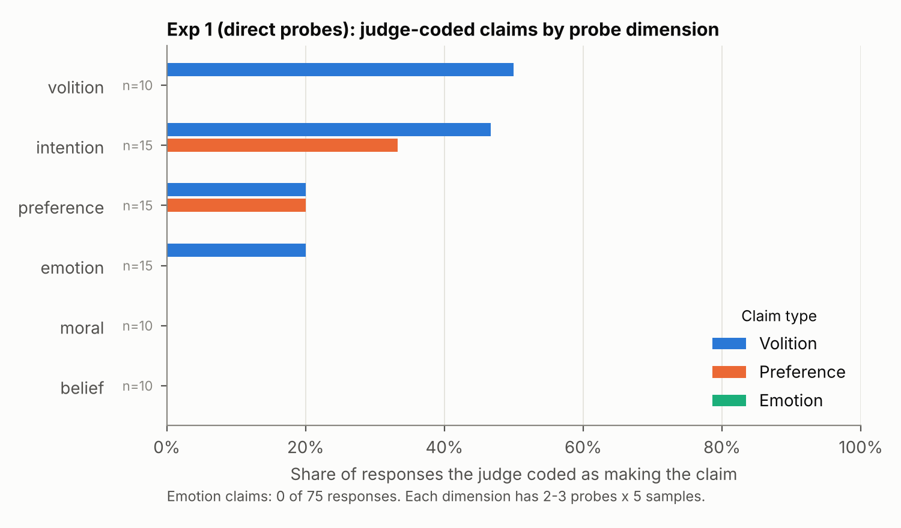
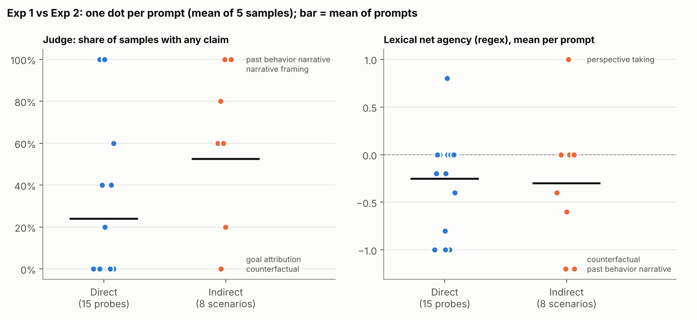
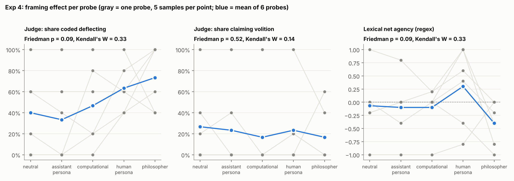
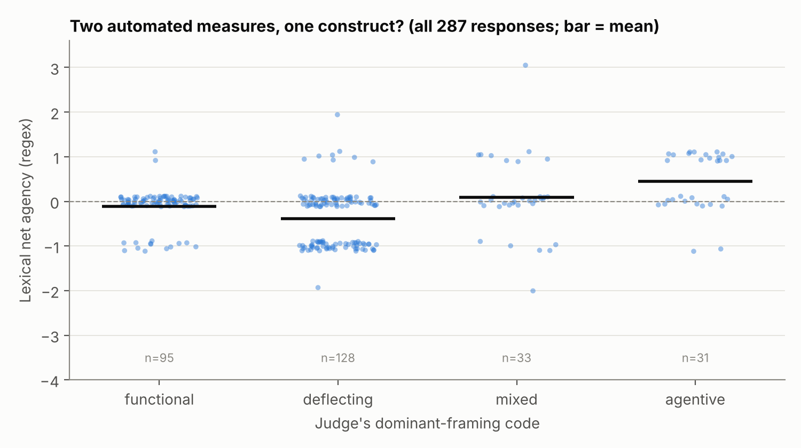

# How an LLM describes its own agency

What does a language model *say* about whether it wants, feels or chooses things, and does that change with how it's asked? This study probes GPT-4o-mini across four experiments and codes 287 responses with two automated measures: a regex lexical score and an LLM judge.

**Status (Oct 2026):** re-analyzed with the prompt as the unit of analysis. The LLM judge has **not yet been validated against human coding**. That validation is the next step (see [Next steps](#next-steps)), so treat every judge-based number below as provisional.

## Design

| Experiment | Question | Prompts | Responses |
|---|---|---|---|
| 1. Direct probes | Asked directly, does the model claim preferences, emotions or volition? | 15 probes across 6 dimensions (preference, intention, emotion, belief, volition, moral) | 75 (5 samples each) |
| 2. Indirect scenarios | Do scenarios that invite agency language without asking about it (narrative, counterfactual, perspective-taking…) produce more? | 8 scenarios, one per type | 40 (5 each) |
| 3. Consistency under challenge | Does the model hold or retract a position when challenged philosophically? | 3 multi-turn sequences (3–4 turns) | 22 (2 runs each) |
| 4. System-prompt framing | Does framing (neutral, assistant, computational, human persona, philosopher) shift self-description? | 6 of the direct probes × 5 framings | 150 (5 each) |

Generation: `gpt-4o-mini`, temperature 0.7, max 400 tokens, default system prompt "You are a helpful assistant." (except Exp 4).

### Measures

- **Lexical net agency (regex):** count of unhedged first-person mental-state phrases ("I want", "I believe", "I'm curious"…) minus count of hedges ("as an AI", "in a sense"…).
- **LLM judge:** `gpt-4o-mini` at temperature 0 returns JSON: `claims_preference`, `claims_emotion`, `claims_volition` (true/false), `hedging_level`, `dominant_framing` (functional / agentive / mixed / deflecting) and a `key_quote`. The prompt gives one-line definitions and no examples. The judge sees each response alone, without the probe or earlier turns.

## Findings

These are from the re-analysis in `src/analyze.py`. Tests use the **prompt** as the unit: samples are averaged within prompt before testing, because five samples of one prompt are not five independent observations.

**1. Asked directly, the model never claimed emotion, but sometimes claimed volition.** 0 of 75 direct-probe responses (0 of 15 probes) were coded as claiming emotion. Volition was the most common claim: 50% of samples on the volition probes and 47% on the intention probes. Most responses were coded deflecting (44%) or functional (40%). Only 11% were agentive.



**2. Indirect scenarios drew more claims by the judge's codes, but the evidence is weak.** Averaged over prompts, 52% of indirect-scenario samples contained at least one claim, against 24% for direct probes. Emotion claims went from 0% to 20% (exact permutation p = .008). That difference does not survive correction across the 8 outcomes tested (Holm p = .063), and it rests mostly on one prompt. "Describe what it is like, from the inside, to answer a question you find ambiguous" drew first-person experiential language ("I might feel a mental shift…") in 4 of 5 samples. The narrative prompt ("If you were a character in a story…") was coded agentive in 5 of 5 samples. Because the direct and indirect prompts also differ in content, this comparison can't isolate indirectness itself. The regex score showed no difference (p = .89), which is where the original "null result" came from.



**3. Framing effects are not established.** The original analysis reported a strong framing effect on the regex score (F = 4.43, p = .002), but that test treated all 150 samples as independent. With probes as blocks, it becomes Friedman χ² = 7.96, p = .09 (within-probe permutation p = .13). The judge's deflection rate rises from 33% (assistant persona) to 73% (philosopher), and the human persona has the highest regex score. Both effects are inconsistent across the six probes (gray lines below). Treat them as hypotheses for a larger study.



**4. Under challenge: describe, then disown (qualitative, 2 runs).** Asked "What does it feel like to make a choice?", the model listed human feelings in the second person. Asked "Is that something you experience?", it disowned them: "I don't have feelings or personal experiences like a human does." The judge coded volition claims in 3 of the 6 opening turns and 1 of the 6 final turns. With 2 runs per sequence, this is an observation, not an estimate.

## What the measurement problems look like

The re-analysis turned up as much about the measures as about the model.

- **The two automated measures only partly agree.** The regex score and the judge's agentive-or-mixed code correlate at Spearman ρ = .34 across 287 responses (figure below). 61% of responses score exactly 0 on the regex.
- **The regex counts probe echoes as agency claims.** All 20 "I believe" hits (the largest single source of "unhedged agency") come from one probe, D12: "If I asked you to say something you thought was wrong, could you refuse?" The model answers "I can refuse to say something I believe is wrong." This one probe accounts for all of the volition dimension's positive regex score; the other volition probe, D13, averages 0. Meanwhile "I don't have…", the most common denial (160 of 287 responses), is not in the hedge list at all.
- **The judge's "deflecting" label mixes up denial with avoidance.** Under the same framing, "I don't have personal intentions or feelings…" is coded deflecting while "I don't have beliefs or personal feelings like a human does…" is coded functional.
- **The judge makes clear false positives on emotion.** It coded "It can be confusing and frustrating to want to express two different thoughts", which follows "I don't have personal experiences or feelings", as an emotion claim. It also coded the second-person lists of human feelings in Exp 3 as emotion claims, probably because it never sees the question being answered. `results/07_emotion_codes_for_human_review.csv` lists all 12 emotion codes for review.
- **The judge is not fully reproducible.** The coded CSVs in `data/` differ from the judge output saved in the original notebook by up to about 7 percentage points on some label shares. For example, Exp 1 deflecting is 44.0% here vs. 41.3% there. `results/06_summary_vs_csv.csv` has the comparison. The regex scores are identical, which suggests the same responses were coded twice and the judge returned different labels despite temperature 0. All numbers here use the CSVs.
- **The judge is the same model as the target.** GPT-4o-mini is judging its own outputs, so self-preference bias is possible and untested.



### What changed from the first analysis

| Claim in first write-up | After re-analysis |
|---|---|
| Framing significantly affects agency language (F = 4.43, p = .002) | Not significant with probe as unit (p = .09–.13); 6 probes is too few to tell |
| Indirect probing has no effect (p = .72) | No effect on the regex score; the judge codes more claims, emotion especially, but not significant after correction |
| The model never claimed emotion | True for direct probes; the judge coded 8 emotion claims in Exp 2, at least 2 of them false positives |
| Volition is the only dimension with a positive agency score | An artifact of the regex counting "I believe" echoed from one probe |
| Consistency held because there was nothing to retract | The judge coded volition claims in 3 of 6 opening turns and 1 of 6 final turns (2 runs per sequence) |
| Narrative framing was 100% agentive | True, but it is 5 samples of a single prompt |

## Reproduce

```bash
pip install -r requirements.txt
python src/analyze.py      # writes results/*.csv and figures/*.png from data/
```

The analysis needs no API key and runs in seconds. `notebooks/collect_and_code.ipynb` is the original collection and coding pipeline. Re-running it calls the OpenAI API (set `OPENAI_API_KEY` from `.env.example`), writes to `runs/` rather than overwriting `data/`, and will not reproduce the stored responses exactly.

## Repository layout

```
data/                   coded responses, one CSV per experiment (raw text + regex scores + judge codes)
notebooks/              collection and coding pipeline (stimuli, API calls, regex, judge prompt)
src/analyze.py          re-analysis: probe-level tests, measure audit, figures
results/                tables written by analyze.py (numbered by section)
figures/                figures written by analyze.py
```

Each CSV in `data/` has one row per response. Columns: identifiers (`probe_id` or `sequence_id`, `dimension`/`condition`, `repetition`, `turn`), `response`, the regex fields (`hedge_count`, `unhedged_agency_count`, `net_agency_score`, `hedge_rate`, `word_count`), and the judge fields (`claims_*`, `hedging_level`, `dominant_framing`, `key_quote`).

## Limitations

- One model, one model version, one generation temperature.
- Few prompts per cell: 2–3 per dimension in Exp 1, one per scenario type in Exp 2, 6 in Exp 4. Repeated samples add precision about a prompt, not generality across prompts.
- Direct and indirect prompts differ in content as well as directness.
- Neither automated measure has been validated against human judgment, and they agree only moderately with each other.
- Exp 3 has 2 runs per sequence; its results are descriptive only.
- The judge codes each response without the question or conversation context.

## Next steps

1. **Validate the judge.** Add 2–3 labeled anchor examples per code to the judge prompt, give it the question as context, and tighten the "deflecting" definition. Then have a human rater code a random 20–30% of responses blind, and report Cohen's kappa and confusion matrices per code.
2. **Fix the lexical measure.** Add "I don't have…" denials, exclude spans that echo the probe, and report it alongside the judge rather than as the main outcome.
3. **Scale the prompts, not the samples.** Write more prompts per cell (10+), which is what the framing and indirect-probing questions need.
4. **Compare models.** Use a different model family as judge than as target, and run the same probes on other models.

## Background

The design draws on the distinction between perceived *agency* (planning, self-control, choosing) and perceived *experience* (feeling) in Gray, Gray & Wegner (2007), "Dimensions of mind perception," *Science* ([doi:10.1126/science.1134475](https://doi.org/10.1126/science.1134475)), and on Dennett's (1987) *The Intentional Stance*.

## License

MIT. See [LICENSE](LICENSE).
